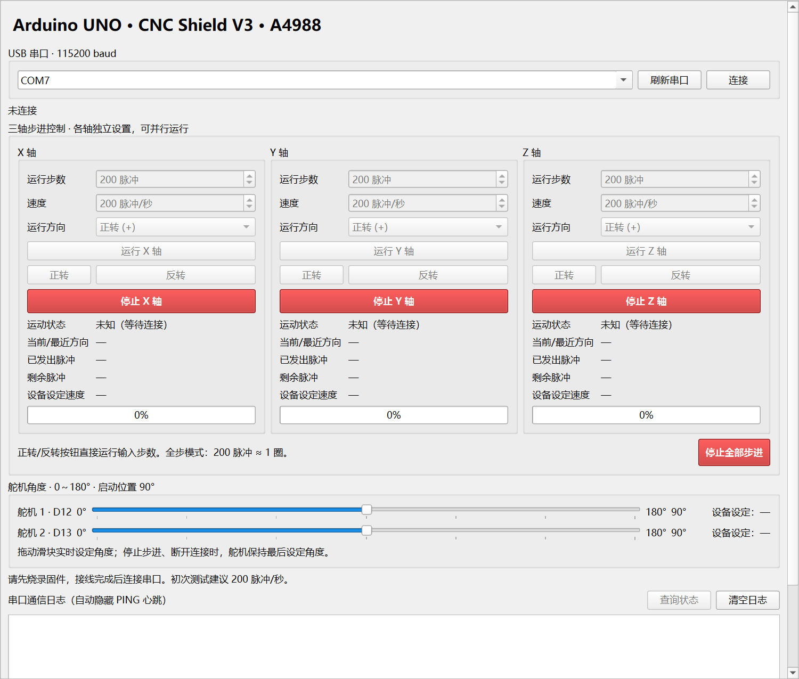

# RoboArm：机械臂建模与控制开源项目

[](LICENSE)

从机械结构建模到桌面控制与 Arduino 固件的完整项目资料仓库。包含 22 个 SolidWorks 零件、3 个装配体、4 个 STEP 文件，以及三轴步进电机与双舵机控制源码、接线说明、协议和模拟测试。代码、文档和作者自有模型采用 [MIT 许可证](LICENSE)。

**快速入口：** [机械建模与模型清单](roboArm%20Model/README.md) · [硬件清单](docs/HARDWARE.md) · [上位机](desktop/) · [固件](arduino/roboarm_x/roboarm_x.ino) · [验证记录](VALIDATION.md) · [贡献指南](CONTRIBUTING.md)

> 当前模型按已有源文件发布。`总装配体.STEP` 使用外部零件引用，部分引用的 STEP 文件不在目录中，不能视为自包含的整机 STEP；详情见建模说明。软件已通过模拟测试及固件编译，实机运动和模型装配完整性仍需验收。

克隆或下载仓库后，在本地项目目录按下方步骤安装。文中的 `D:\roboArm` 仅为 Windows 路径示例，可替换为你的克隆目录。

```powershell
git clone https://github.com/Z-billi/roboArm.git
cd roboArm
python -m venv .venv
.\.venv\Scripts\python.exe -m pip install -r requirements.txt
.\.venv\Scripts\python.exe main.py
```

## 控制系统概览



使用 Python/PySide6 + pyserial 上位机、Arduino UNO 下位机。当前支持 X/Y/Z 三轴步进电机，以及 D12、D13 两个 0～180°位置舵机。步进轴独立运行和计数，可并行运行；舵机使用 Arduino 官方 Servo 库。不需要 GRBL 或 AccelStepper，不提供同步插补。

**2026-10-22：X/Y/Z 改为三个并排的独立控制区，无需切换控制轴。** 每轴均可设置步数、速度、方向，独立运行和停止，并显示各自状态、计数与进度；保留“停止全部步进”和 D12/D13 舵机滑块（0～180°，初始 90°）。本次只修改上位机，使用现有协议 v3 固件时无需重新烧录，关闭旧窗口后重启 `start.bat` 即可。若开发板仍是先前的长按限速版协议 v4，则需烧录项目中的协议 v3 固件。

## 文件作用

| 文件 | 作用 |
| --- | --- |
| `roboArm Model/` | SolidWorks 原生零件、装配体与现有 STEP 导出；见目录内 README |
| `docs/HARDWARE.md` | 控制系统用料及机械复现待补充项 |
| `LICENSE` | MIT 开源许可证 |
| `arduino/roboarm_x/roboarm_x.ino` | 三轴步进、D12/D13 舵机控制、共享 ENABLE、超时停止步进 |
| `main.py` | Windows GUI 入口 |
| `desktop/main_window.py` | X/Y/Z 三个并排控制区、各轴状态和进度、两个舵机滑块、角度反馈、日志；小窗口可滚动 |
| `desktop/serial_worker.py` | 后台串口线程、UNO 复位等待、握手、心跳、停止优先队列、断开处理 |
| `desktop/protocol.py` | 三轴及舵机协议、MOVE/SERVO 参数校验、设备反馈解析 |
| `desktop/__init__.py` | Python 包声明 |
| `requirements.txt` | Python 运行依赖 |
| `start.bat` | 使用项目 `.venv` 双击启动 |
| `tests/test_controller.py` | 无硬件协议、GUI 和模拟串口集成测试 |
| `README.md` | 安装、烧录、协议、测试和排查说明 |
| `VALIDATION.md` | 软件验证结果、开源发布检查及待完成的实机验收 |
| `.gitignore` | 忽略虚拟环境、缓存与验证工具 |

所有源码在本项目目录。`.venv` 是本机依赖环境，`.tools`（如果存在）是验证用工具/构建缓存，不需要烧录或复制到 Arduino。

## 1. 接线和首次通电

先断开 USB 和电机电源再插拔 Shield、A4988 或电机。带电插拔电机可能损坏驱动器。

1. CNC Shield V3 装到 UNO，**X、Y、Z 每个驱动器槽各安装一块 A4988**。逐一核对模块与 Shield 的 **EN、STEP、DIR、VMOT、GND** 标识；不要仅凭电位器朝向判断，不同模块布局可能不同。
2. 三个电机分别接到 X/Y/Z 电机接口。用万用表找出两组线圈，同一线圈的两根线接同一输出对，另一组接另一输出对；不要仅依赖线色。未安装的轴不要发送运动命令。
3. Shield 的电机电源端子接独立直流电源；例如按板卡规格使用 12V 电源，确认极性和电流能力。**USB 只给控制逻辑供电，不能替代电机电源**。A4988 本身允许的 VMOT 范围不代表整个 Shield 的允许范围，以实际板卡额定值为准。
4. 首测使用全步模式：断电后移除 **对应轴槽下三个细分跳线**，200 步/圈电机发 200 脉冲约转一圈。三跳线全装通常是 1/16 细分，需要 3200 脉冲/圈。各轴细分独立配置；软件不会自动识别电机步距角或细分设置。
5. 按电机额定相电流、模块散热能力及实际采样电阻设置 A4988 限流。公式 `I_limit = VREF / (8 × R_sense)`；克隆模块的 R_sense 不一定相同，不能套用一个固定 VREF。需要散热片/风冷时先配置好，初测低速、空载。
6. 确认 Shield 的 RESET/SLEEP 正常拉高、电源共地，VMOT 附近具有足够的电源滤波。若板上电容不足，按驱动器厂商说明补充，并核对耐压和极性。

| 信号 | UNO 引脚 | 说明 |
| --- | --- | --- |
| X STEP | D2 | 每个上升沿算一个脉冲 |
| X DIR | D5 | 默认 HIGH 为正方向、LOW 为负方向 |
| Y STEP | D3 | Y 轴脉冲 |
| Y DIR | D6 | Y 轴方向 |
| Z STEP | D4 | Z 轴脉冲 |
| Z DIR | D7 | Z 轴方向 |
| ENABLE | D8 | LOW 使能，HIGH 释放；Shield 多轴共用 |
| 舵机 1 信号 | D12 | 0～180°，每次 UNO 启动/复位设为 90° |
| 舵机 2 信号 | D13 | 0～180°，每次 UNO 启动/复位设为 90° |
| 串口 | USB | 默认选择 COM7，115200、8N1、无流控 |

**D8 ENABLE 为三轴共用：任何一轴运行，三块驱动器都使能。停止/完成某一轴只停止该轴 STEP，其余轴继续运行；全部轴空闲后统一释放保持力。** 全部停止、断开或超时停止后电机会失去保持力。首测使用无悬挂负载条件，尤其是 Z 轴。GUI 软件停止依赖 USB 传输，不是独立硬件急停。步数是发出的脉冲数，无编码器反馈，无法判断失步、堵转或真实位置。

### D12/D13 舵机接线和使用

- 两个舵机的**信号线**分别接 UNO D12、D13，电源按各自型号的额定电压与电流配置，使用足够容量的独立稳压电源；电源 GND 与 UNO GND 共地。不要把舵机电源接到信号引脚或直接接 Shield 的电机高压电源。外部电源不要与 UNO 5V 输出直接并联。官方接线与供电说明见 [Arduino 舵机排查](https://support.arduino.cc/hc/en-us/articles/360017053760-Troubleshoot-servo-motors)。
- 使用 0～180°位置舵机；连续旋转舵机不适用于本角度控制。D12/D13 在本程序中专用于舵机，不同时用于主轴控制等其他功能。
- UNO 上电、复位、上传固件后，两个舵机都写入 90°；USB 打开串口通常也会触发 UNO 复位，所以重新连接时可能回到 90°。GUI 打开窗口本身不发送运动命令。
- 两条滑块相互独立，拖动即发送目标角度，每 80ms 限频，松开时立即提交最终值。支持点击滑轨和方向键微调。尚未发送的同一舵机旧角度会被新值替换。
- 滑块旁的角度是用户目标；“设备设定”是 Arduino 已确认写入的角度，**不是真实角度传感器反馈**。使用 Servo 默认脉宽映射，实际角度/机械端点应按舵机型号校准，先从 90°附近小幅验证。
- 舵机控制不等待其转动完成，仍可同时控制三轴步进。Servo 库使用定时器中断，UNO 的 D9/D10 `analogWrite` PWM 会受影响；本项目步进使用 D2～D7 普通数字输出。并行时的实际步进抖动和负载表现需实测。参考 [官方 Servo 库](https://github.com/arduino-libraries/Servo/blob/master/docs/readme.md)。
- **“停止全部步进”/STOP ALL 只停止 X/Y/Z，并丢弃尚未发送的舵机目标。舵机在 UNO 仍供电时继续输出最后接受的目标角度，不会自动回中或断力。** 断开/通信超时同样保持舵机最后目标；无法据此保证立即停止正在转动的舵机。UNO 再次复位时恢复 90°。

## 2. Arduino IDE 烧录

1. 安装 [Arduino IDE](https://www.arduino.cc/en/software)，连接 UNO USB。
2. IDE 打开 `D:\roboArm\arduino\roboarm_x\roboarm_x.ino`，保持文件与 `roboarm_x` 文件夹同名。
3. 在开发板管理器安装 **Arduino AVR Boards**，选择 **Arduino Uno**；工具 → 端口选择实际端口（预计 COM7）。
   在 IDE 的“库管理器”搜索 **Servo**，安装作者为 **Michael Margolis、Arduino** 的官方库（本项目用 1.3.0 编译验证）。若提示 `Servo.h: No such file or directory`，先安装该库。
4. 关闭本项目控制软件以及所有占用串口的程序。点“验证”，通过后点“上传”。此固件会替换板上原有程序。
5. 可选：串口监视器设置 **115200** 和“新行”或“NL 和 CR”，应看到 `READY protocol=3 axes=X,Y,Z servos=D12,D13`，以及轮流的步进/舵机状态。发送 `STATUS`、`SERVO_STATUS` 检查；监视器不要与 GUI 同时连接。
6. 上传完成后关闭串口监视器，再启动 GUI。打开串口会让 UNO 复位，GUI 自动等待约两秒并发 `STOP ALL`/`STATUS`/`SERVO_STATUS` 握手，收到全停确认、三轴停止状态和两个舵机状态后才开放控制。

Arduino 侧只新增官方 Servo 库；Windows 的 Python 依赖保持不变。

## 3. Windows 安装依赖

使用 Windows 10/11、64 位 Python 3.10～3.13（建议 3.12），安装 Python 时勾选加入 PATH。PowerShell 打开项目目录：

```powershell
cd D:\roboArm
python -m venv .venv
.\.venv\Scripts\python.exe -m pip install -r requirements.txt
```

无需激活虚拟环境，不受 PowerShell 脚本执行策略影响。如果 `python` 打开 Microsoft Store，先安装正式 Python 并重开终端，也可将第一条命令的 `python` 改为已安装的 `py -3.12`。若目录已有可用 `.venv`，可以跳过创建命令。打包后的 `.exe` 暂未包含，本版本通过 Python 或 `start.bat` 运行。

## 4. 启动软件

```powershell
cd D:\roboArm
.\.venv\Scripts\python.exe main.py
```

或双击 `start.bat`。启动不自动连接、不自动运行。没有插入 Arduino 也可以打开界面。

## 5. 连接与三轴验收

1. 接线和限流确认后上电，点“刷新串口”，选择 COM7（以设备管理器实际端口为准），点“连接”。可手工输入 COM 名称。
2. 等待连接状态显示“已连接”，日志应出现 TX `STOP ALL`、`STATUS`、`SERVO_STATUS`，RX `OK STOP_ALL`、三轴停止状态和 D12/D13 舵机角度。旧版固件需要重新烧录。
3. 在 **X 轴控制区**设置 **200 步、200 脉冲/秒**，点该区“正转”：约一秒完成，出现 DONE，已发出 200、剩余 0；200 步/圈电机全步模式约一圈。然后分别在 Y、Z 控制区重复测试。三轴同时显示，先逐轴验证再并行运行。
4. 点“反转”，应反方向回转相同步数。也可从方向下拉框选择后点“运行”。按钮都是有限步数运动，不是无限连续转。
5. 改为 400 步测试约两圈。默认电机 200 整步/圈，圈数 = 脉冲数 / (200 × 细分倍率)。速度单位是脉冲/秒，例如全步 500 脉冲/秒约为 150 RPM。
6. 在 X 轴控制区设置 **10000 步、200 脉冲/秒**，点“运行 X 轴”，运行中点“停止 X 轴”。应迅速停止、状态 STOPPED，已发出 + 剩余 = 总步数。再点运行是新任务，不会续跑之前的剩余步数。三轴步数、速度、方向分别设置，运行中的轴暂时禁用新运行命令，其他空闲轴仍可操作。
7. 在 Y 轴控制区运行长任务，再直接在 Z 轴控制区运行长任务；也可以加入 X 轴任务。每个控制区显示本轴状态、方向、已发出/剩余脉冲、设备设定速度和进度。点击“停止 Y 轴”时，其他运行轴应继续运行。点击“停止全部步进”应停止三轴。运动中点“断开”或关闭窗口，GUI 先发 `STOP ALL` 再关闭串口。
8. 在无负载测试条件下验证异常断线：运行长任务后拔掉 USB，Arduino 若仍有供电，应在最后有效心跳约 **1.5 秒**后停止；若断电则立即失去驱动。重新连接只读取状态，不会自动恢复运动。
9. 低速正常后逐渐增加速度。此最小版本**没有加减速曲线**，直接起步的高速度可能失步；2000 是软件上限，不保证所有电机能可靠达到。
10. 舵机先从 90°小幅拖到 80°、100°，分别验证 D12/D13 映射和方向，再按实际机械范围检查更大角度。日志应有 `SERVO D12 100` 和 `OK SERVO D12 angle=100`，另一舵机保持原值；GUI 角度范围为 0～180°。
11. 运行低速步进任务时拖动舵机，检查两者是否都正常；“停止全部步进”和断开后，舵机应维持最后目标。重新连接 UNO 若发生复位，两个舵机应回到 90°。

本次更新三轴控制界面；实际角度、供电、机械端点以及三轴/舵机并行行为仍需实机验收，未自动连接硬件。A 轴暂未启用。

## 6. 通信协议 v3

ASCII、大写命令、LF 换行；兼容 CRLF；最大 79 字符（不含换行）。速度是正整数 STEP 脉冲/秒 1～2000，步数是非零整数 −1000000～1000000。

```text
MOVE X 200 500
MOVE X -200 500
MOVE Y 400 200
MOVE Z -200 200
STOP X
STOP Y
STOP Z
STOP ALL
STATUS
STATUS X
STATUS Y
STATUS Z
SERVO D12 90
SERVO D13 180
SERVO_STATUS
SERVO_STATUS D12
PING
```

- `MOVE X/Y/Z`：正号为正方向、负号为反方向；接受后返回对应轴 `OK ...` 和 `RUNNING ...`。各轴独立运行，不保证同时起步或同步完成。
- `STOP X/Y/Z`：只结束指定轴任务，保留计数，返回对应轴 `STOPPED ... reason=USER`。空闲时也可执行。
- `STOP ALL`：先停止全部三轴，再返回 `OK STOP_ALL`；当前计数通过后续 STATUS 更新。
- `STATUS`：返回三轴状态；`STATUS X/Y/Z`：只返回指定轴状态。正常通信负载下约每 80ms 在三轴和两个舵机之间轮流反馈，每个设备约 400ms 更新一次。
- `SERVO D12/D13 <角度>`：角度为 0～180 的整数，返回 `OK SERVO D12 angle=90` 等已设定反馈。错误为 `ERROR servo=D12 code=ANGLE_RANGE`、`BAD_NUMBER` 或 `SERVO_UNSUPPORTED`。
- `SERVO_STATUS`：查询两个舵机设定；`SERVO_STATUS D12/D13` 查询指定舵机，返回 `SERVO D12 angle=90`。普通 `STATUS` 只查询步进轴。
- `PING`：返回 `OK PING`；GUI 每约 300ms 自动发送并隐藏心跳日志。
- 运动中超过 1500ms 没有有效 PING/STATUS/SERVO_STATUS/STOP/接受的 MOVE 或 SERVO，自动停止所有运行步进轴，返回 `STOPPED ... reason=LINK_TIMEOUT`；舵机维持最后目标。
- 同一轴运动期间新 MOVE 返回 `ERROR axis=Y code=BUSY` 等带轴名错误；其他空闲轴仍可开始运行。STOP 不清零已有计数。

响应示例：

```text
READY protocol=3 axes=X,Y,Z servos=D12,D13
SERVO D12 angle=90
OK SERVO D13 angle=120
OK X state=RUNNING dir=FORWARD total=200 completed=0 remaining=200 speed=500 reason=NONE
RUNNING X state=RUNNING dir=FORWARD total=200 completed=0 remaining=200 speed=500 reason=NONE
STATUS X state=RUNNING dir=FORWARD total=200 completed=80 remaining=120 speed=500 reason=NONE
DONE X state=DONE dir=FORWARD total=200 completed=200 remaining=0 speed=500 reason=NONE
STOPPED X state=STOPPED dir=FORWARD total=10000 completed=250 remaining=9750 speed=200 reason=USER
OK STOP_ALL
ERROR axis=A code=AXIS_UNSUPPORTED
```

`completed`/`remaining` 是**本次**脉冲数；`dir` 在停止/完成后保留最近方向，刚复位为 NONE。`speed` 是设定值，未测量实际转速。错误码还有 `BAD_COMMAND`、`BAD_NUMBER`、`STEPS_RANGE`、`SPEED_RANGE`、`BUSY`、`LINE_TOO_LONG`。非法命令不会启动电机或改变原任务。

串口监视器手动测试长运动时，也必须每 1.5 秒内发有效 PING 或 STATUS；否则自动停止。短命令 `MOVE X 200 500` 正常可在超时前结束。

实现采用固定长度接收缓冲、固定长度发送队列和 `micros()` 调度。唯一等待是 3µs STEP 高脉冲，STOP 无需等待整段运动结束；软件串口/USB 调度仍有延迟，未承诺硬件急停时限。发送队列满时可能丢弃反馈行，运动和 STOP 仍执行，后续 STATUS 恢复当前状态。避免人为高速灌入大量命令。

## 7. 故障排查

| 现象 | 检查顺序 |
| --- | --- |
| 电机不转 | 先确认选对轴、已连接、该轴有 RUNNING/DONE；再查独立电机电源和极性、对应槽 A4988 安装、驱动器方向、两组线圈、限流、RESET/SLEEP；按引脚表核对 STEP/DIR，EN=D8 共用。DONE 仅证明脉冲已发出，不能证明电机真的转动。 |
| 只抖动/嗡嗡响 | 断电后用万用表重新配对线圈；降低到 100～200 脉冲/秒并空载；检查供电、限流、接触、散热和机械卡阻。无加速的高速启动尤其容易失步。 |
| 方向相反 | 正负方向只是软件约定。断电后交换**同一线圈**的两根线，或将固件对应 `INVERT_X_DIRECTION` / `INVERT_Y_DIRECTION` / `INVERT_Z_DIRECTION` 改为 `true` 后重新烧录；任选一种方式。不要把两个线圈混接。 |
| 转角不对 | 核对电机是否 200 整步/圈和细分跳线。1/16 时 200 脉冲只约 1/16 圈；若跳线正确，检查高速/过载造成的失步。 |
| COM7 不存在 | 刷新串口；查看 Windows 设备管理器“端口 (COM 和 LPT)”实际编号；换可传数据的 USB 线。克隆 UNO 可能需要其实际 USB 串口芯片（例如 CH340）的官方驱动。 |
| Access denied / 无法打开 | 关闭 Arduino 串口监视器、绘图器、其他控制软件或第二个 GUI；拔插 USB；确认选择正确端口。 |
| 连接后三轴确认超时 | 确认重新烧录了新版此 `.ino`，有 X/Y/Z 状态且 STOP ALL 返回 OK STOP_ALL；选 UNO、正确 COM、115200。旧版单 X 固件、GRBL 或其他固件不兼容，重新上传后再连接。 |
| 舵机状态确认超时 / 滑块灰色 | 必须重新上传协议 v3 固件，检查 `SERVO_STATUS` 是否返回 D12/D13。只收到三轴状态的旧版固件不支持舵机。 |
| 舵机不动、抖动或 UNO 复位 | 核对 D12/D13 信号线、舵机供电电压/电流与共地；不要依赖 UNO USB 给两个舵机供电。对比日志“设备设定”与目标值，再检查机械负载、端点和型号是否为位置舵机。 |
| 重连后舵机回到 90° | UNO 打开串口常会复位，固件启动写入 90°，属于当前设计；保持机构在回中时不会碰撞。 |
| 运行一会自动停止 | 日志查看 LINK_TIMEOUT 或设备响应超时；检查 USB 供电/接触、驱动器噪声导致 UNO 复位（READY 再出现）、供电去耦和散热。手动串口测试长任务需要心跳。 |
| 停止后轴能被手转 / 停止轴仍有保持力 | D8 共用，所有轴空闲才关闭 ENABLE；只要另一轴仍在运行，停止轴也会保持使能。承重机构需先设计独立制动/保持策略。 |
| GUI 不能启动 | 用终端启动查看报错；确认使用 `.venv\Scripts\python.exe` 且已安装 requirements；不要把项目命名为 `serial.py` 或 `PySide6.py`。 |

## 8. 软件测试与扩展边界

```powershell
.\.venv\Scripts\python.exe -m unittest discover -s tests -v
```

测试使用模拟串口，不打开 COM7、不驱动电机。真实烧录与运行结果请按第五节验收。

固件使用 `Axis` 注册表，Python 使用 `AXES` 和带轴名的命令/反馈。以后扩展 A 轴还需明确实际 Shield 跳线和引脚映射，再更新握手能力、状态反馈和测试。本版本不含回零、限位、绝对坐标、加减速或同步插补；三个轴同时高速度运行的实际频率和抖动需实测，不保证总脉冲吞吐达到各轴最大速度之和。

参考官方资料：[A4988 接线、细分和限流](https://www.pololu.com/product/1182)、[A4988 数据手册](https://www.pololu.com/file/0J450/A4988.pdf)、[Qt 后台线程与信号](https://doc.qt.io/qtforpython-6/PySide6/QtCore/QThread.html)、[pyserial 串口 API](https://pyserial.readthedocs.io/en/stable/pyserial_api.html)。
